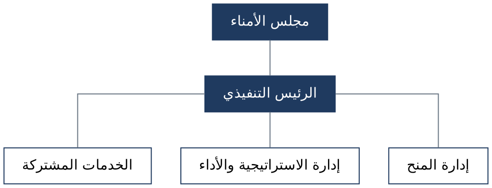
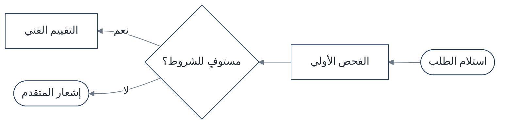
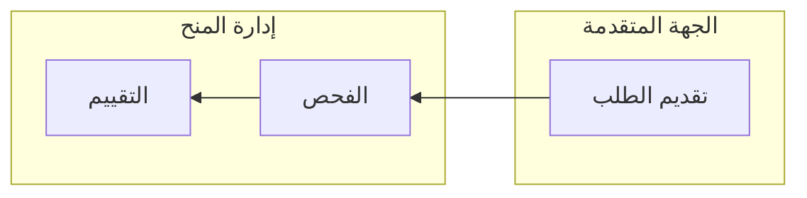

# الرسم الفعلي: الأوامر والقوالب المجرّبة

جُرّبت هذه القوالب في أكتوبر ٢٠٢٦ على Graphviz وMermaid CLI ‏11، وظهرت فيها الحروف العربية صحيحة.

## ١. التأكد من وجود خط عربي

```bash
fc-list | grep -i "arabic" | head -3
```

إذا لم يظهر شيء، فثبّت خطًا مفتوح الترخيص من مستودع Google Fonts:

```bash
mkdir -p ~/.fonts && cd ~/.fonts
for w in Regular Bold; do
  curl -fsSLO "https://raw.githubusercontent.com/google/fonts/main/ofl/ibmplexsansarabic/IBMPlexSansArabic-$w.ttf"
done
fc-cache -f
```

إذا تعذّر التنزيل، فاذكر ذلك للمستخدم، واقترح عرض المخطط داخل المحادثة بشيفرة Mermaid بدل الصورة.

## ٢. هيكل تنظيمي بـGraphviz



```bash
dot -Tpng -Gdpi=200 org.dot -o org.png
```

- `splines=ortho` يعطي خطوطًا قائمة الزوايا، وهو الشكل المألوف في الهياكل التنظيمية.
- للعلاقات الاستشارية (لجنة تتبع المجلس دون أن تكون في خط السلطة) يُستعمل خط متقطع: `edge [style=dashed]`.
- لوضع وحدات في المستوى نفسه: `{rank=same; C; D; E;}`.

## ٣. مخطط تدفق بـMermaid



الأشكال: `([...])` بداية أو نهاية، و`[...]` خطوة، و`{...}` قرار.

مسارات حسب الجهة:



## ٤. تحويل Mermaid إلى صورة

يحتاج إلى Node.js ومتصفح Chromium.

```bash
npm i -s @mermaid-js/mermaid-cli@11.4.2
echo '{"args":["--no-sandbox"]}' > pp.json
npx mmdc -p pp.json -i flow.mmd -o flow.png -s 2 -b white
```

- إذا لم يجد الأداة متصفحًا، فأضف إلى `pp.json` المفتاح `"executablePath"` بمسار Chromium المثبت.
- إذا تعذّر تثبيت الأداة، فأعد رسم المخطط بـGraphviz (`rankdir=RL` لمخطط التدفق)، أو اعرضه داخل المحادثة.

## ٥. أشكال PowerPoint الأصلية

عند بناء ملف PowerPoint برمجيًا وطلب المستخدم مخططًا قابلًا للتعديل:
- مربع لكل عقدة، ونص محاذى لليمين واتجاه فقرة من اليمين إلى اليسار.
- موصلات (connectors) بين المربعات، لا خطوط حرة، حتى تبقى متصلة عند التحريك.
- يُحسب موقع كل مستوى من اليمين: العقدة الأولى في أقصى اليمين.
