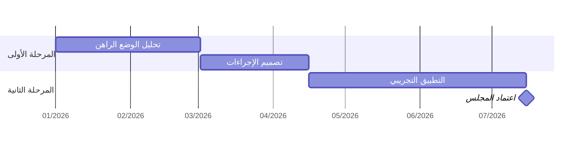

# صيغ التسليم

## صورة لـWord أو PowerPoint

- عبر `scripts/gantt.py`. للصفحة العمودية عرض ١٦ سم تقريبًا، وللشريحة 16:9 عرض الشريحة ناقص الهوامش.
- إذا لم يكن الخط العربي مثبتًا:

```bash
mkdir -p ~/.fonts && cd ~/.fonts
curl -fsSLO "https://raw.githubusercontent.com/google/fonts/main/ofl/ibmplexsansarabic/IBMPlexSansArabic-Regular.ttf"
fc-cache -f
```

ثم مرّر مسار الملف إلى السكربت بالخيار `--font`.

## ملف Excel قابل للتحرير

مناسب حين يحدّث الفريق الجدول بنفسه:
- ورقة باتجاه من اليمين إلى اليسار.
- أعمدة ثابتة: المهمة، والمرحلة، والمسؤول، وتاريخ البداية، وتاريخ النهاية، والحالة.
- أعمدة أسابيع أو أشهر بعدها، تُلوَّن بالتنسيق الشرطي بصيغة تقارن تاريخ العمود بتاريخي البداية والنهاية. بهذا يتحدث المخطط تلقائيًا عند تغيير التاريخ.
- تجميد الأعمدة الثابتة والصف الأول.
- لا تُكتب الألوان يدويًا، فهي تفسد عند أول تعديل.

## جدول المراحل البسيط

| المرحلة | المدة | المخرج الرئيس | نقطة القرار |
| --- | --- | --- | --- |
| [اسم المرحلة] | [من – إلى] | [المخرج] | [الجهة المعتمدة] |

## عرض سريع داخل المحادثة (Mermaid)



يجري محور الزمن هنا من اليسار إلى اليمين، وتظهر تسمية المعلم مائلة. لذلك لا يصلح هذا الشكل للوثائق الرسمية.
